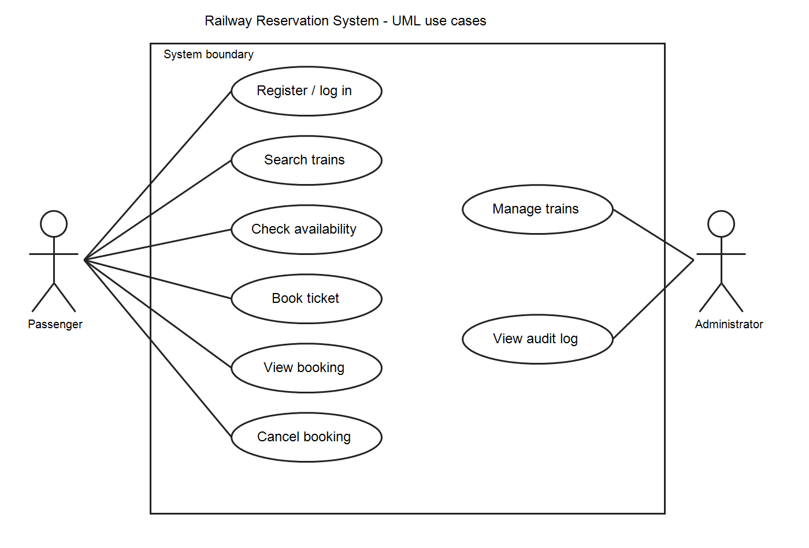
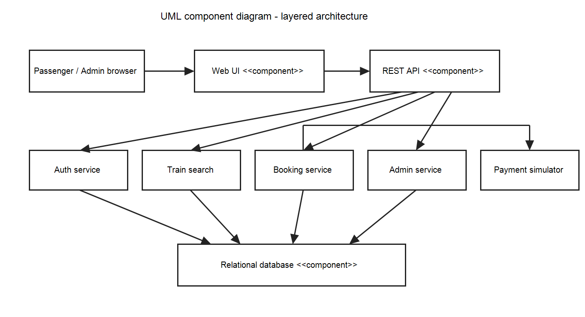
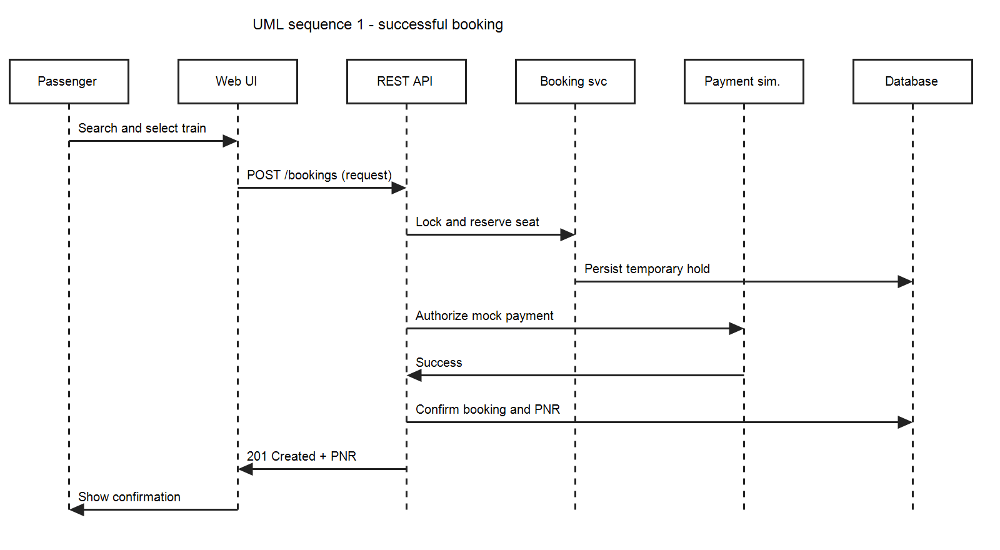
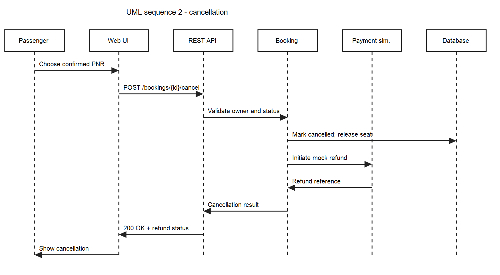

# Railway Reservation System

### Software Engineering Mini Project · Team E15

> Part 1 documentation for a proposed railway reservation system. The repository contains the requirements, test plan, architecture and design specification, and test case update. Application code is not part of this submission.

[Read the PDF](docs/Team_E15_Railway_Reservation_System.pdf) · [Download the Word document](docs/Team_E15_Railway_Reservation_System_Part_1.docx)

## Project at a glance

Passengers can search trains, check seats, make a reservation, view their bookings, and cancel an eligible booking. Administrators maintain train and seat information and review audit events. The design uses a **payment simulator** for booking and refund flows; it does not process real payments.



## Part 1 deliverables and team

Each deliverable has one responsible team member. The fourth deliverable is included in §5.2 of the test plan, as required by the assignment.

1. **Software Requirements Specification** — Mohit Singh P (`PES1UG24CS273`). Functional and non-functional requirements, security objectives and requirements, and a UML use case diagram.
2. **Test Plan** — Atharv More (`PES1UG24CS276`). Test strategy, environment, security validation, entry and exit criteria, and SRS traceability.
3. **Software Architecture and Design Specification** — Mohammed Rizwan shaikh (`PES1UG24CS272`). Architecture pattern, component descriptions, security architecture, API design, error handling, and two UML sequence diagrams.
4. **Test case update to the Test Plan** — Muhammad Affan Dumba (`PES1UG24CS280`). Ten specified cases covering functional, non-functional, and security requirements.

## Design visuals

### Component view

The proposed browser UI calls a REST API, which coordinates authentication, train search, booking, administration, a payment simulator, and a relational database.



<details>
<summary><strong>Booking sequence</strong></summary>

The booking flow reserves a seat, checks the simulated payment result, and confirms a booking with a PNR only on success.



</details>

<details>
<summary><strong>Cancellation sequence</strong></summary>

The cancellation flow checks booking ownership and status, releases the seat once, and records a simulated refund reference.



</details>

## How to review this submission

1. Open the [PDF](docs/Team_E15_Railway_Reservation_System.pdf) for a read-only view or the [Word document](docs/Team_E15_Railway_Reservation_System_Part_1.docx) for editing.
2. Read **Deliverable 1** for the requirement IDs (`FR`, `NFR`, and `SEC`).
3. Read **Deliverable 2** and its §5.2 test case update to see how those requirements will be verified.
4. Read **Deliverable 3** for component and sequence diagrams, API contracts, and design traceability.

The test cases are **specifications**, not recorded test results. Their actual results and evidence are to be filled in when an implementation is available.

## Repository contents

```text
README.md
docs/
  Team_E15_Railway_Reservation_System.pdf
  Team_E15_Railway_Reservation_System_Part_1.docx
assets/diagrams/
  use_case.png
  components.png
  sequence_booking.png
  sequence_cancellation.png
```

## Standards referenced

The documents use the structure and terminology of [ISO/IEC/IEEE 29148:2018](https://standards.ieee.org/ieee/29148/6937/) for requirements, [ISO/IEC/IEEE 29119-3:2021](https://standards.ieee.org/ieee/29119-3/7499/) for test documentation, and [IEEE 1016:2009](https://standards.ieee.org/ieee/1016/4502/) for software design descriptions.
