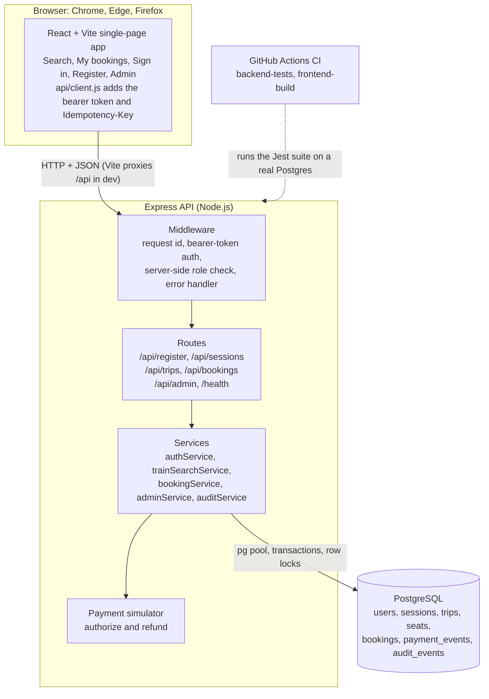
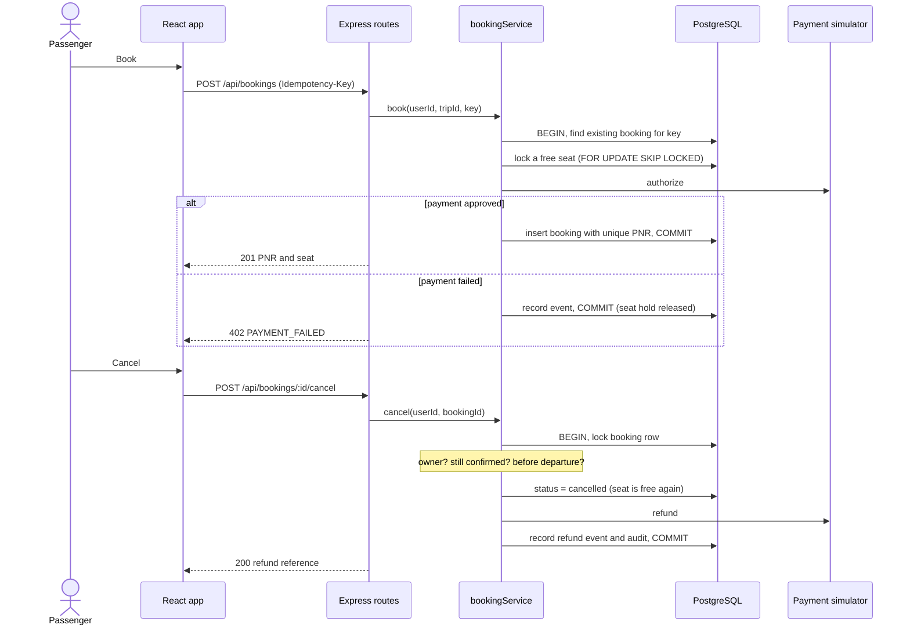
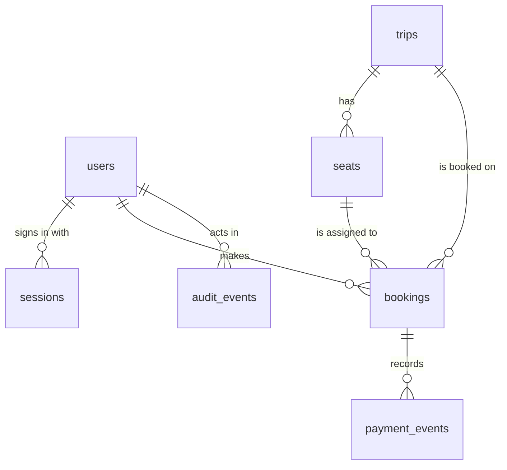

# Architecture overview — Railway Reservation System (Team E15)

A one-page picture of how the running system is put together. It is drawn from the code on `main`
and complements the formal design document
[`03_Architecture_Design_Mohammed_Rizwan_Shaikh_PES1UG24CS272.pdf`](../03_Architecture_Design_Mohammed_Rizwan_Shaikh_PES1UG24CS272.pdf)
(Figure 1 there is the layered component view; Figures 2 and 3 are the booking and cancellation sequences).

The diagrams are [Mermaid](https://mermaid.js.org/) and render directly on GitHub.

## 1. System and component view

| Layer | What it does | Code |
|---|---|---|
| Frontend | Passenger and admin screens, keyboard-accessible, responsive to 375 px | `frontend/src/` |
| Middleware | Tags each request with an id, authenticates the bearer token, enforces roles on the server (SEC-01), returns `{code, message, requestId}` errors | `backend/src/middleware/` |
| Routes | Thin HTTP handlers, one file per area | `backend/src/routes/` |
| Services | Business rules and transactions: sign-in and lockout, search, booking, cancellation, admin changes, audit | `backend/src/services/` |
| Payment simulator | Deterministic stand-in for a payment provider (also used to force failures in tests) | `backend/src/paymentSimulator.js` |
| Database | System of record; schema and demo data are created by `npm run migrate` | `backend/src/db/` |

## 2. Request flow: booking and cancellation

## 3. Data model

Two database rules carry the correctness guarantees:

- `one_confirmed_booking_per_seat`: a partial unique index (`WHERE status = 'confirmed'`), so a seat can never be confirmed twice and cancelling frees it.
- `UNIQUE (user_id, idempotency_key)`: a retried booking request returns the original booking.

## 4. Security and operations notes

- Passwords are stored as salted hashes (SEC-02); five failed sign-ins lock an account for 15 minutes (SEC-04).
- Every sign-in, booking, cancellation and admin change is written to `audit_events` (FR-09).
- `GET /health` supports restart and recovery checks (NFR-04).
- HTTPS is configured for deployment (see [`HTTPS_DEPLOYMENT.md`](HTTPS_DEPLOYMENT.md)) but has not been exercised on a deployed instance yet, so it is not claimed as verified.
