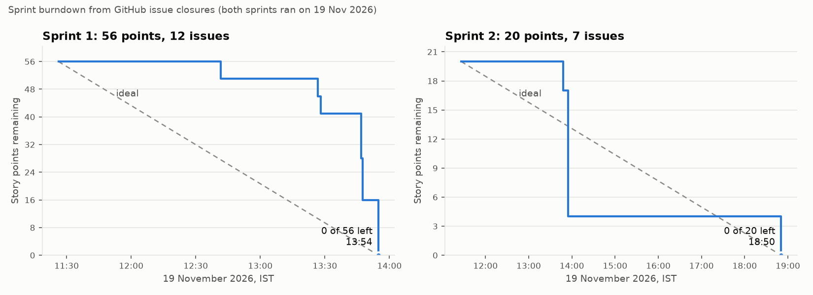

# Sprint burndown — Team E15

Burndown for both sprints, built from the repository's real data with
[`scripts/burndown.py`](../scripts/burndown.py). Story points are each issue's `SP n` label, the sprint
is its milestone, and a point is burned at the moment GitHub recorded the issue as closed. Nothing is
estimated or smoothed: each step is one issue closing. Re-run with `python scripts/burndown.py`.

As recorded in [`SPRINT_LOG.md`](SPRINT_LOG.md) and [`DEVIATIONS.md`](DEVIATIONS.md), both sprints
were run as one compressed session on 19 November 2026 instead of the planned 19–30 October window,
so the time axis is hours, not days. The sprint start is the first commit pushed to `main` that day
(11:26 IST).

## What the charts show

| | Sprint 1 | Sprint 2 |
|---|---|---|
| Committed | 56 points, 12 issues | 20 points, 7 issues |
| Completed | 56 points, 12 issues | 20 points, 7 issues |
| First issue closed | 12:41 (#7, audit logging) | 13:48 (#4, availability) |
| Last issue closed | 13:54 | 18:50 (#18, #19) |
| Shape | Flat, then a steep drop as the feature pull requests merged in order | 16 points burned at 13:55 alongside Sprint 1; the last 4 points waited for the browser and keyboard evidence |

**Reading it honestly.** A burndown that stays flat and then falls steeply is the classic sign of work
being closed in batches rather than continuously, and that is what happened: issues were closed when
their pull requests merged, and the pull requests were merged in a fixed order (foundation → admin →
cancellation → passenger → security → availability) within about 75 minutes. Sprint 2's tail is the
two NFR-05/NFR-06 issues, which needed the three-browser matrix to be run and recorded before they
could close. Sprint 2 burned 16 of its 20 points by 13:55, within seconds of Sprint 1's last issue,
because the availability, performance and recovery work was merged in the same session; only #4
(availability) closed earlier, at 13:48.

## Data

Every closure, also in [`evidence/burndown/closures.csv`](evidence/burndown/closures.csv):

| Sprint | Issue | Points | Assignee | Closed (IST) |
|---|---|---|---|---|
| 1 | #7 FR-09 audit logging | 5 | ThouSyntaxTerror | 12:41:36 |
| 1 | #11 FR-08 admin CRUD | 5 | TheNonConformist | 13:26:37 |
| 1 | #10 FR-07 cancellation | 5 | affandumba | 13:28:04 |
| 1 | #1 FR-01 registration | 5 | MACHINEKILLER07 | 13:46:53 |
| 1 | #3 FR-03 search | 8 | MACHINEKILLER07 | 13:46:54 |
| 1 | #9 SEC-03 HTTPS and session expiry | 5 | ThouSyntaxTerror | 13:47:27 |
| 1 | #8 SEC-02 password hashing | 2 | ThouSyntaxTerror | 13:47:27 |
| 1 | #12 SEC-01 access control | 5 | ThouSyntaxTerror | 13:47:29 |
| 1 | #2 FR-02 authentication | 3 | MACHINEKILLER07 | 13:54:49 |
| 1 | #5 FR-05 booking | 5 | affandumba | 13:54:51 |
| 1 | #6 FR-06 booking history | 3 | MACHINEKILLER07 | 13:54:52 |
| 1 | #13 SEC-04 lockout | 5 | affandumba | 13:54:53 |
| 2 | #4 FR-04 availability | 3 | TheNonConformist | 13:48:05 |
| 2 | #14 NFR-01 search performance | 3 | TheNonConformist | 13:54:55 |
| 2 | #15 NFR-02 booking performance | 3 | TheNonConformist | 13:54:56 |
| 2 | #16 NFR-03 last-seat race | 5 | TheNonConformist | 13:54:57 |
| 2 | #17 NFR-04 restart recovery | 2 | ThouSyntaxTerror | 13:54:59 |
| 2 | #18 NFR-05 keyboard accessibility | 2 | affandumba | 18:50:39 |
| 2 | #19 NFR-06 browser compatibility | 2 | affandumba | 18:50:41 |

Closing an issue records who it was **assigned** to, not who wrote the code; for that, see the commit
history and [`AFFAN_SPRINT_REPORT.md`](AFFAN_SPRINT_REPORT.md) for one member's breakdown.
